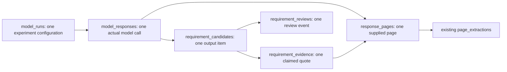

# Requirements warehouse extension

This is the first increment of the remaining data-engineering work. It adds six core tables, a review-queue view and a checksum-protected migration ledger. It does not load pilot results, claim the whole DE layer is finished, or modify the existing seven tables.

## Relationships and grain



Keep retry calls distinct. Reimporting the same artifact must reuse its ID; the upcoming loader will use the existing insert-or-verify convention. A single GPU receipt may cover many calls. Raw malformed outputs remain in model_responses but cannot create requirement_candidates. Empty valid arrays produce no candidates. Parsed JSON and schema flags must be independently validated by the loader; the database is not a JSON-schema validator.

Evidence claims may be wrong or refer to a nonexistent page. Store them with exact_quote_match=false and an unmapped position when appropriate. Mapped claims must refer to pages supplied to that response, and a trigger verifies the substring flag. Exact substring matching is not semantic correctness.

Only a review event explicitly identified as human can accept a candidate, with a nonempty reviewed requirement payload. This is an application audit convention, not user authentication. Reviews are append-only: insert a new event to reopen or correct a decision. Acceptance does not resolve amendments or establish bid readiness.

The loader must ensure exactly one target per completed response, verify source text hashes, enforce context policy, validate raw output and candidate counts against the schema, preserve immutable original artifacts, and restrict mapped citations to the appropriate input. This migration enforces at most one target and valid source references; it does not yet enforce all loader invariants.

## Installation on school CPU

Upload the ZIP into the project root. Extract using the safe extraction cell supplied in chat; it refuses to overwrite differing existing files. Then run:

```bash
/opt/conda/bin/python scripts/apply_requirement_schema.py
/opt/conda/bin/python scripts/apply_requirement_schema.py
/home/jovyan/.conda/envs/gbr-postgres/bin/psql -X -w -h /home/jovyan/.gbr-pg-socket -U jovyan -d georgia_bid_readiness -v ON_ERROR_STOP=1 -f warehouse/tests/002_requirement_schema.sql
```

The second migration call should verify the checksum and skip changes. The SQL test uses synthetic fixtures within a rolled-back transaction. A test failure also rolls back when psql exits. Identity sequences may advance; no fixture rows are committed. Existing project data is not used as test data.

Use PGHOST, PGPORT, PGUSER, PGDATABASE and PGPASSWORD for CI; no credentials are stored in these files. Existing psycopg dependency is sufficient. Apply migration 001 first in a new CI database, then execute scripts/apply_requirement_schema.py. Keep the existing pipeline tests and add the SQL test as a separate CI step. Do not overwrite the existing workflow before integrating it deliberately.

## Remaining increments

1. Transactional pilot-artifact loader with conflict detection, repeat-load tests and CI integration.
2. Canonical reviewed requirements, amendment relationships and unresolved conflicts.
3. Business-profile documents, assessment history and readiness statuses.
4. Analytical facts/dimensions with explicit grains, refresh orchestration and full backup/restore verification.

Do not interpret this schema-only delivery as completion of those increments.
